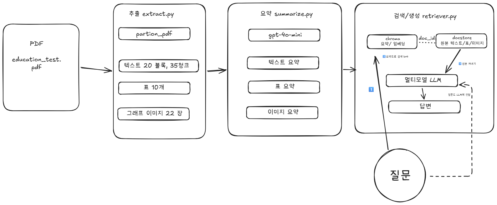
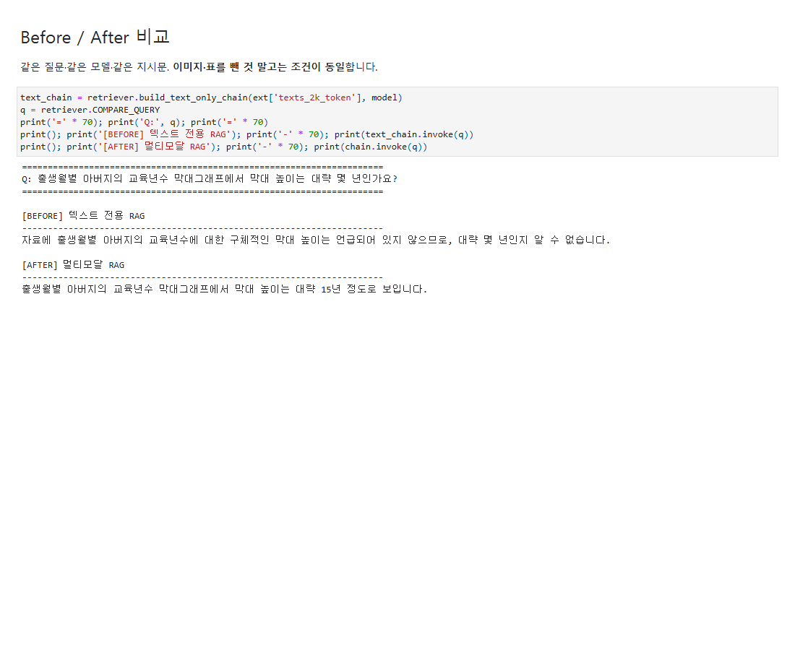
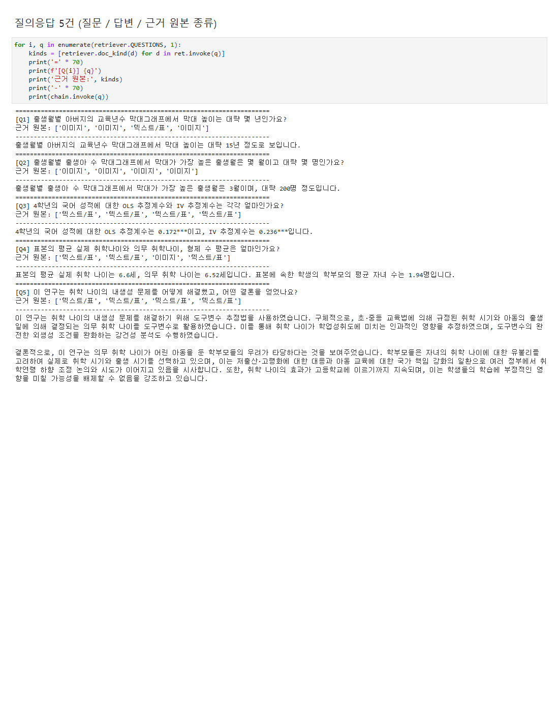

# 멀티모달 RAG — 취학 나이와 학업성취도 논문

한국어 논문 PDF 한 편(`data/education_test.pdf`)에서 텍스트·표·그래프를 추출해 요약하고,
요약으로 검색한 뒤 원본을 멀티모달 LLM에 넘겨 답하는 RAG입니다.

## 1. 문제 정의

이 논문은 핵심 근거의 상당 부분이 글이 아니라 그래프와 표에 있습니다.

- 출생월별 출생아 수, 부모 교육년수 같은 분포는 막대·산점도 그래프로만 제시됩니다.
- 학년별·과목별 OLS·IV 추정 결과는 회귀표에 있고, 숫자 나열이라 일반 텍스트 요약으로는 의미가 사라집니다.

그래서 텍스트만 읽는 RAG는 "그래프에서 막대 높이가 얼마인가?" 같은 질문에 "자료에 없습니다"라고 답할 수밖에 없습니다.
이 프로젝트는 그래프와 표까지 검색 대상에 넣어 이런 질문에도 근거 있는 답을 하는 것이 목표입니다.

## 2. 아키텍처



## 3. 요약으로 검색하고 원본으로 생성하는 이유

<!-- TODO -->

- **요약으로 검색:** 이미지는 임베딩을 직접 만들 수 없고, 표는 숫자 묶음이라 질문과 의미가 맞붙지 않습니다.
  그림이 무엇을 보여주는지 글로 요약해 두면 질문과 같은 언어로 검색할 수 있습니다.
- **원본으로 생성:** 요약은 정보가 깎인 상태라 이미지 요약에는 대략적인 수치만 남습니다.
  막대 높이의 정확한 값은 원본 이미지를 LLM이 직접 봐야 읽을 수 있습니다.
- **연결:** 요약과 원본에 같은 `doc_id`를 붙여, 요약으로 찾은 뒤 id로 원본을 꺼냅니다.

## 4. 기술 선택과 근거

- 수업시간에 배운 것을 위주로 사용

| 항목 | 선택 | 근거 |
| --- | --- | --- |
| PDF 파싱 | `unstructured` `hi_res` | 레이아웃 분석으로 표 구조와 그림 영역까지 추출 |
| 텍스트 청크 | 2k 토큰, overlap 200 | 한 청크에 한 주제가 담길 만큼 크면서 요약 비용이 과하지 않은 크기 |
| 요약·답변 모델 | `gpt-4o-mini` | 이미지 입력을 지원하면서 저렴 |
| 임베딩 | `text-embedding-3-small` | 한국어 요약문 검색에 충분하고 저렴 |
| 텍스트·표 요약 프롬프트 | 한국어 | 질문이 한국어라 요약도 한국어여야 매칭됨 |
| 이미지 요약 프롬프트 | 영어 지시, 한국어 결과 | 지시문은 영어가 효율적이고, 결과는 한국어여야 검색 가능 |
| 저장소 | Chroma, `InMemoryStore` | 설치 없이 로컬 실행, 과제 규모에 충분 |

## 5. 실행 방법

```bash
python -m venv .venv
.venv\Scripts\activate
pip install -r requirements.txt
# Poppler, Tesseract 설치 후 PATH 등록

copy .env.example .env     # .env 에 OPENAI_API_KEY 입력

python src/extract.py      # 1단계: 추출
python src/summarize.py    # 2단계: 요약
python src/retriever.py    # 3단계: 질의응답 + Before/After
```

실행 결과가 남아 있는 노트북: [`notebooks/Multi_modal_RAG.ipynb`](notebooks/Multi_modal_RAG.ipynb)

## 6. Before / After 비교

같은 질문, 같은 모델, 같은 지시문입니다. 이미지·표를 뺀 것 말고는 조건이 동일합니다.

- **Before:** 텍스트만 저장한 RAG
- **After:** 텍스트·표·이미지 요약을 쓰는 멀티모달 RAG

**질문:** 출생월별 아버지의 교육년수 막대그래프에서 막대 높이는 대략 몇 년인가요?



- **Before:** 자료에 막대 높이가 언급되어 있지 않아 알 수 없다고 답했습니다.
- **After:** 대략 15년 정도라고 답했습니다.

이 수치는 본문에 없고 그래프에만 있습니다. 텍스트 전용 RAG는 그래프를 색인하지 못해 근거가 없지만,
멀티모달 RAG는 그래프를 요약해 검색한 뒤 원본 이미지를 LLM에 직접 보여주므로 값을 읽어낼 수 있었습니다.

## 7. 질의응답 5건

| # | 질문 | 답변 | 근거가 된 원본 |
| --- | --- | --- | --- |
| 1 | 출생월별 아버지의 교육년수 막대그래프에서 막대 높이는 대략 몇 년인가요? | 대략 15년 정도 | 이미지 |
| 2 | 출생월별 출생아 수 막대그래프에서 막대가 가장 높은 출생월은 몇 월이고 대략 몇 명인가요? | 3월, 대략 200명 | 이미지 |
| 3 | 4학년의 국어 성적에 대한 OLS 추정계수와 IV 추정계수는 각각 얼마인가요? | OLS 0.172\*\*\*, IV 0.236\*\*\* | 표 |
| 4 | 표본의 평균 실제 취학나이와 의무 취학나이, 형제 수 평균은 얼마인가요? | 실제 6.6세, 의무 6.52세, 평균 1.94명 | 표 |
| 5 | 이 연구는 취학 나이의 내생성 문제를 어떻게 해결했고, 어떤 결론을 얻었나요? | 의무 취학나이를 도구변수로 사용해 인과효과를 추정. 효과가 고등학교까지 이어질 수 있어 정책 논의가 필요하다는 결론 | 텍스트 |



Q2는 가장 높은 달(3월)은 맞혔지만 인원을 약 200명으로 읽어, 실제 막대 값(약 480)과 크게 어긋났습니다.
Q4는 형제 수를 자녀 수로 잘못 표현했습니다.

## 8. 한계

- **이미지 요약이 부실하면 검색에 실패합니다.** "출생월별 의무 취학나이 vs 실제 취학나이" 산점도를 묻는 질문은
  해당 이미지가 검색되지 않았고, 멀티모달 RAG가 12월이라고 틀리게 답했습니다.
  이미지 요약이 "산점도, 점이 배치됨" 수준이면 비슷한 막대·산점도 그래프 22장이 구분되지 않습니다.
- **그래프 수치는 근사치입니다.** 모델이 눈으로 읽은 값이라 Q2처럼 크게 어긋날 수 있습니다.
- **검색은 요약 품질에 전적으로 의존합니다.**
- **`InMemoryStore`는 휘발성입니다.** 실행할 때마다 색인을 다시 만듭니다.
- **PDF 1편, 질문 5건의 소규모 검증이라 일반화하기 어렵습니다.**
